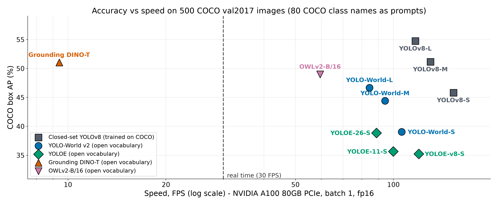
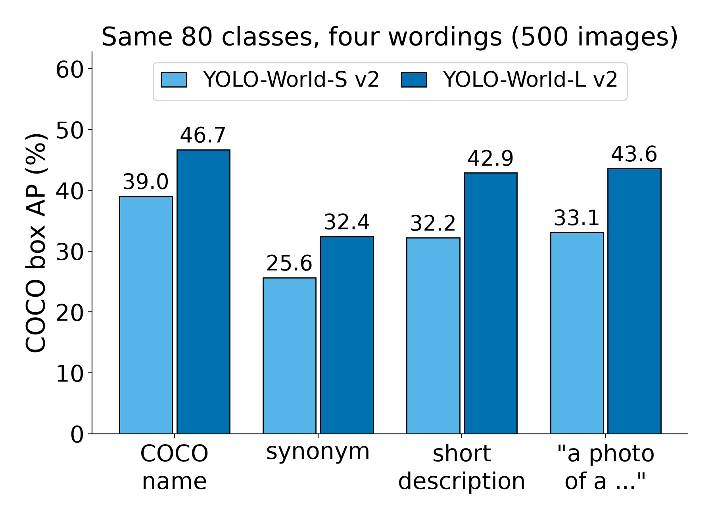
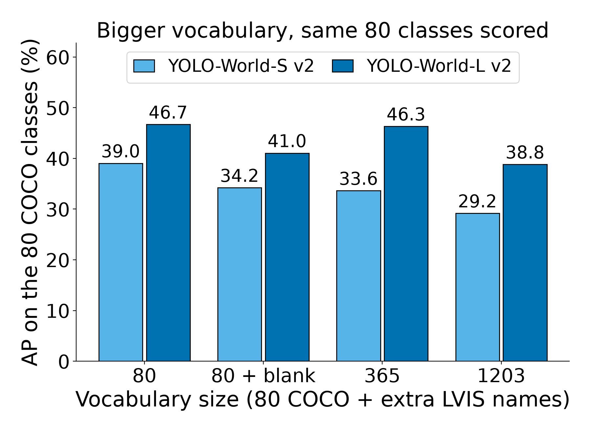
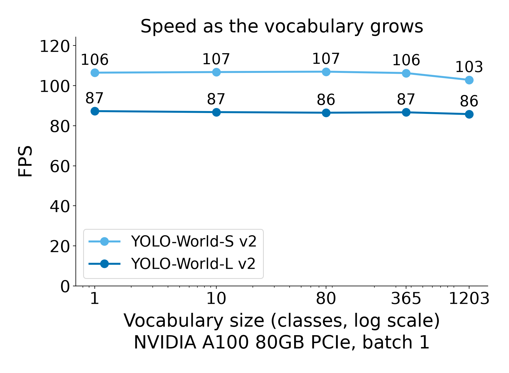

# Results

Generated by `experiments/make_report.py` from the CSVs in this folder. Do not edit by hand.

**Hardware and software:** NVIDIA A100 80GB PCIe, driver 580.178.04, torch 2.6.0+cu124 (CUDA 12.4), ultralytics 8.4.166, transformers 5.17.0, Python 3.12.15, Linux-4.18.0-553.150.1.el8_10.x86_64-x86_64-with-glibc2.28

**Data:** 500 COCO val2017 images (fixed seed 0, ids in `coco_subset_ids.json`), scored with pycocotools box AP (IoU 0.50:0.95, max 100 detections per image).

**Settings for every model:** the 80 plain COCO class names as the vocabulary, score threshold 0.001, batch size 1, fp16. Speed = median wall-clock time per image for pre-processing + forward pass + post-processing with the image already in memory, after warm-up, with nothing else on the GPU. FPS = 1000 / that median. No TensorRT and no `torch.compile`.

## Experiment 1: accuracy and speed

| Model | Open vocab | AP | AP50 | APs | APm | APl | ms / image | FPS | Detector params (M) | Text encoding, 80 names (ms) | Peak VRAM (MB) |
|---|---|---|---|---|---|---|---|---|---|---|---|
| YOLOv8-S (closed-set) | no | 45.8 | 63.6 | 29.2 | 49.7 | 62.0 | 6.5 | 152.9 | 11.2 | - | 85 |
| YOLOv8-M (closed-set) | no | 51.1 | 68.7 | 37.1 | 55.7 | 66.8 | 7.7 | 129.9 | 25.9 | - | 192 |
| YOLOv8-L (closed-set) | no | 54.7 | 71.8 | 40.3 | 59.9 | 70.3 | 8.6 | 116.8 | 43.7 | - | 335 |
| YOLO-World-S v2 | yes | 39.0 | 54.3 | 25.5 | 43.9 | 52.6 | 9.4 | 106.0 | 12.8 | 12.9 | 882 |
| YOLO-World-M v2 | yes | 44.4 | 60.7 | 30.5 | 48.9 | 58.4 | 10.6 | 94.2 | 28.4 | 12.8 | 1006 |
| YOLO-World-L v2 | yes | 46.7 | 62.7 | 33.2 | 51.2 | 59.1 | 11.8 | 84.4 | 46.8 | 12.9 | 998 |
| YOLOE-v8-S | yes | 35.2 | 51.0 | 21.4 | 40.0 | 49.0 | 8.4 | 119.6 | 15.4 | 36.9 | 1137 |
| YOLOE-11-S | yes | 35.7 | 51.0 | 21.7 | 40.4 | 49.5 | 10.0 | 99.9 | 13.7 | 36.8 | 1152 |
| YOLOE-26-S | yes | 38.9 | 54.8 | 26.5 | 43.8 | 56.0 | 11.3 | 88.7 | 15.3 | 40.9 | 558 |
| Grounding DINO-T | yes | 51.0 | 66.7 | 39.3 | 54.6 | 64.7 | 106.8 | 9.4 | 63.4 | 10.8 | 1183 |
| OWLv2-B/16 | yes | 49.0 | 69.1 | 37.2 | 52.8 | 66.6 | 16.8 | 59.5 | 91.6 | 12.3 | 428 |

### YOLO-World against closed-set YOLOv8 of the same size

| Size | YOLOv8 AP | YOLO-World AP | AP gap | YOLOv8 FPS | YOLO-World FPS | YOLO-World speed |
|---|---|---|---|---|---|---|
| S | 45.8 | 39.0 | -6.8 | 152.9 | 106.0 | 69% |
| M | 51.1 | 44.4 | -6.7 | 129.9 | 94.2 | 73% |
| L | 54.7 | 46.7 | -8.1 | 116.8 | 84.4 | 72% |

The closed-set YOLOv8 models were trained on COCO itself and YOLO-World was not, so some gap in AP is expected.

### What each model was trained on

| Model | Checkpoint | Training data |
|---|---|---|
| YOLOv8-S (closed-set) | `weights/yolov8s.pt` | Supervised on COCO train2017 (all 80 classes) |
| YOLOv8-M (closed-set) | `weights/yolov8m.pt` | Supervised on COCO train2017 (all 80 classes) |
| YOLOv8-L (closed-set) | `weights/yolov8l.pt` | Supervised on COCO train2017 (all 80 classes) |
| YOLO-World-S v2 | `weights/yolov8s-worldv2.pt` | O365v1 + GoldG (GQA + Flickr30k, COCO images excluded), per the official model zoo; converted by Ultralytics |
| YOLO-World-M v2 | `weights/yolov8m-worldv2.pt` | O365v1 + GoldG (GQA + Flickr30k, COCO images excluded), per the official model zoo; converted by Ultralytics |
| YOLO-World-L v2 | `weights/yolov8l-worldv2.pt` | O365v1 + GoldG (GQA + Flickr30k, COCO images excluded), per the official model zoo; converted by Ultralytics |
| YOLOE-v8-S | `weights/yoloe-v8s-seg.pt` | O365v1 + GoldG (GQA + Flickr30k, COCO images excluded) with SAM 2.1 pseudo-masks (YOLOE paper) |
| YOLOE-11-S | `weights/yoloe-11s-seg.pt` | O365v1 + GoldG (GQA + Flickr30k, COCO images excluded) with SAM 2.1 pseudo-masks (YOLOE paper) |
| YOLOE-26-S | `weights/yoloe-26s-seg.pt` | O365v1 + GoldG (GQA + Flickr30k, COCO images excluded) with SAM 2.1 pseudo-masks (YOLOE paper) |
| Grounding DINO-T | `IDEA-Research/grounding-dino-tiny` | O365 + GoldG + Cap4M (groundingdino_swint_ogc; official repo model zoo) |
| OWLv2-B/16 | `google/owlv2-base-patch16-ensemble` | CLIP pre-train; self-train on WebLI pseudo-boxes; fine-tune on LVIS-base (COCO train2017 images); weight ensemble |

## Sanity check of the evaluation pipeline

| Model | Pipeline | AP | AP50 | Ultralytics internal mAP | Official reference |
|---|---|---|---|---|---|
| yolov8s | compare.py predict() path (single-label NMS, max_det 100) | 45.8 | 63.6 | - | 44.9 (Ultralytics docs, full val2017, 5000 imgs) |
| yolov8s-worldv2 | compare.py predict() path (single-label NMS, max_det 100) | 39.0 | 54.3 | - | 37.7 (Ultralytics docs, zero-shot COCO val2017) |
| yolov8s | Ultralytics model.val() (multi-label NMS, max_det 300 -> top-100 per image) | 46.4 | 64.7 | 45.8 | 44.9 (Ultralytics docs, full val2017, 5000 imgs) |
| yolov8s-worldv2 | Ultralytics model.val() (multi-label NMS, max_det 300 -> top-100 per image) | 40.0 | 54.9 | 39.5 | 37.7 (Ultralytics docs, zero-shot COCO val2017) |

The official numbers are for all 5,000 val2017 images; mine are for the subset, so a small difference is expected.

## Experiment 2: prompts

### A. Wording: the same 80 classes, four ways to name them

| Model | name (AP) | synonym (AP) | description (AP) | template (AP) | best - worst |
|---|---|---|---|---|---|
| YOLO-World-S v2 | 39.0 | 25.6 | 32.2 | 33.1 | 13.4 |
| YOLO-World-L v2 | 46.7 | 32.4 | 42.9 | 43.6 | 14.3 |

Synonyms by kind (mean of per-class AP over the classes of that kind that have ground truth in the subset):

**YOLO-World-S v2**

| Kind of synonym | Classes | AP with COCO name | AP with synonym | Change |
|---|---|---|---|---|
| synonym | 35 | 44.8 | 33.3 | -11.5 |
| near | 21 | 35.4 | 20.3 | -15.1 |
| weak | 14 | 29.0 | 11.0 | -18.1 |
| expansion | 5 | 44.3 | 40.1 | -4.2 |
| scientific | 2 | 32.0 | 7.6 | -24.4 |
| spelling | 1 | 42.2 | 40.2 | -2.0 |

Largest drops: giraffe as "camelopard" (69.2 to 12.9); bear as "bruin" (91.0 to 38.6); toaster as "toast maker" (56.4 to 6.4); horse as "steed" (67.2 to 20.3); zebra as "Equus quagga" (59.7 to 13.9)

**YOLO-World-L v2**

| Kind of synonym | Classes | AP with COCO name | AP with synonym | Change |
|---|---|---|---|---|
| synonym | 35 | 51.7 | 40.6 | -11.1 |
| near | 21 | 42.6 | 26.2 | -16.4 |
| weak | 14 | 39.7 | 16.2 | -23.4 |
| expansion | 5 | 50.9 | 49.5 | -1.4 |
| scientific | 2 | 36.3 | 13.2 | -23.1 |
| spelling | 1 | 53.9 | 54.1 | +0.1 |

Largest drops: giraffe as "camelopard" (74.2 to 7.4); toaster as "toast maker" (59.8 to 3.8); snowboard as "snow deck" (55.4 to 0.0); bowl as "basin" (55.0 to 3.7); parking meter as "parking timer" (50.4 to 0.0)

### C. Vocabulary size and accuracy

AP on the 80 COCO classes when the vocabulary also contains other words. `80+blank` adds one blank entry, the padding the official YOLO-World demos add (the authors say it "might improve" the scores). The larger vocabularies add LVIS category names. `predict()` keeps one label per box, and a box whose label is one of the added words is dropped before scoring, so a box that goes to a near-synonym (LVIS "sofa" for COCO "couch", "doughnut" for "donut") or to the blank entry counts as a miss. Part of the drop below comes from that.

| Model | 80 | 80+blank | 365 | 1203 |
|---|---|---|---|---|
| YOLO-World-S v2 | 39.0 | 34.2 | 33.6 | 29.2 |
| YOLO-World-L v2 | 46.7 | 41.0 | 46.3 | 38.8 |

### B. Vocabulary size and speed

This is a separate timing run from experiment 1, so the 80-class FPS differs a little from the table at the top.

| Model | Classes | Text encoding, once (ms) | ms / image | FPS | ms / image at conf 0.25 |
|---|---|---|---|---|---|
| YOLO-World-S v2 | 1 | 24.3 | 9.39 | 106.5 | 9.18 |
| YOLO-World-S v2 | 10 | 13.1 | 9.36 | 106.8 | 9.10 |
| YOLO-World-S v2 | 80 | 15.8 | 9.35 | 107.0 | 9.32 |
| YOLO-World-S v2 | 365 | 76.1 | 9.41 | 106.3 | 9.34 |
| YOLO-World-S v2 | 1203 | 231.9 | 9.72 | 102.9 | 9.29 |
| YOLO-World-L v2 | 1 | 11.2 | 11.45 | 87.3 | 11.13 |
| YOLO-World-L v2 | 10 | 12.6 | 11.52 | 86.8 | 11.32 |
| YOLO-World-L v2 | 80 | 15.9 | 11.56 | 86.5 | 11.53 |
| YOLO-World-L v2 | 365 | 68.5 | 11.54 | 86.7 | 11.45 |
| YOLO-World-L v2 | 1203 | 216.0 | 11.65 | 85.8 | 11.49 |

## Notes

- These numbers are not comparable with the paper. The paper reports zero-shot Fixed AP on LVIS minival and FPS on a V100. This is standard COCO AP on a 500-image subset, on a different GPU, with fp16.
- COCO is not a test of new classes. None of the open-vocabulary models were trained on COCO's box labels (OWLv2 was fine-tuned on LVIS, whose images are COCO training images), but the 80 COCO classes are common words that all of them have seen. The closed-set YOLOv8 models were trained on COCO directly.
- The YOLO models keep one class per box (Ultralytics `predict()`), while OWLv2 and Grounding DINO keep the top 100 box-class pairs. The sanity check above shows this costs the YOLO models 0.6 to 1.0 AP compared with `model.val()`.
- FPS uses the median time per image. The three closed-set YOLOv8 models were timed first and had a few very slow frames (a standard deviation of 5 to 8 ms on a 6 to 8 ms median), so the mean made them look slower than they are. Mean and standard deviation are in `compare.csv`.
- Peak VRAM for YOLO-World includes the CLIP model that Ultralytics keeps loaded, so it is not the detector alone.
- The checkpoints are YOLO-World v2 (no Image-Pooling Attention, BatchNorm instead of L2-Norm in the head). Ultralytics caches the text embeddings after `set_classes()`; it does not fold them into the convolution weights like the paper does. The text encoder still runs only once per vocabulary.
- The YOLOE checkpoints are segmentation models run as box detectors. The mask branch still runs, so a box-only YOLOE would be a bit faster.
- Grounding DINO runs its text branch on every image. Its official zero-shot COCO AP on the full val set is 48.4; I measured 51.0 on this subset and did not sanity-check it the way I did the YOLO models. OWLv2 runs at 960x960, the YOLO models at 640.
- With 500 images, differences of a few tenths of an AP point don't mean much. Two classes (hair drier, scissors) have no ground truth in the subset, so AP is a mean over 78 classes.
- The synonyms in `experiments/prompts.json` go from real synonyms to weak ones on purpose. The by-kind table separates them.
